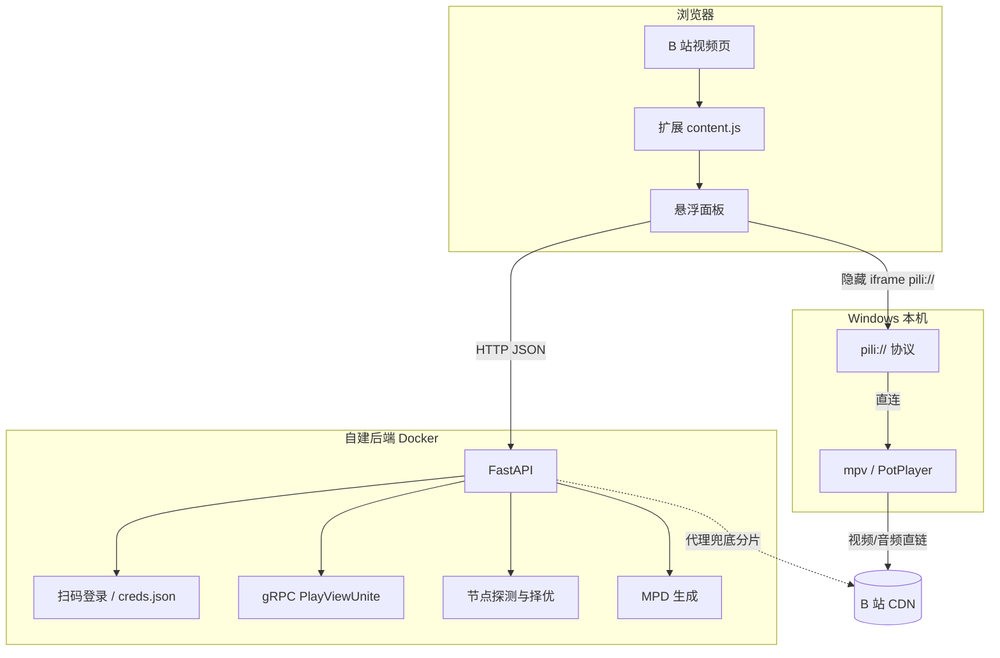
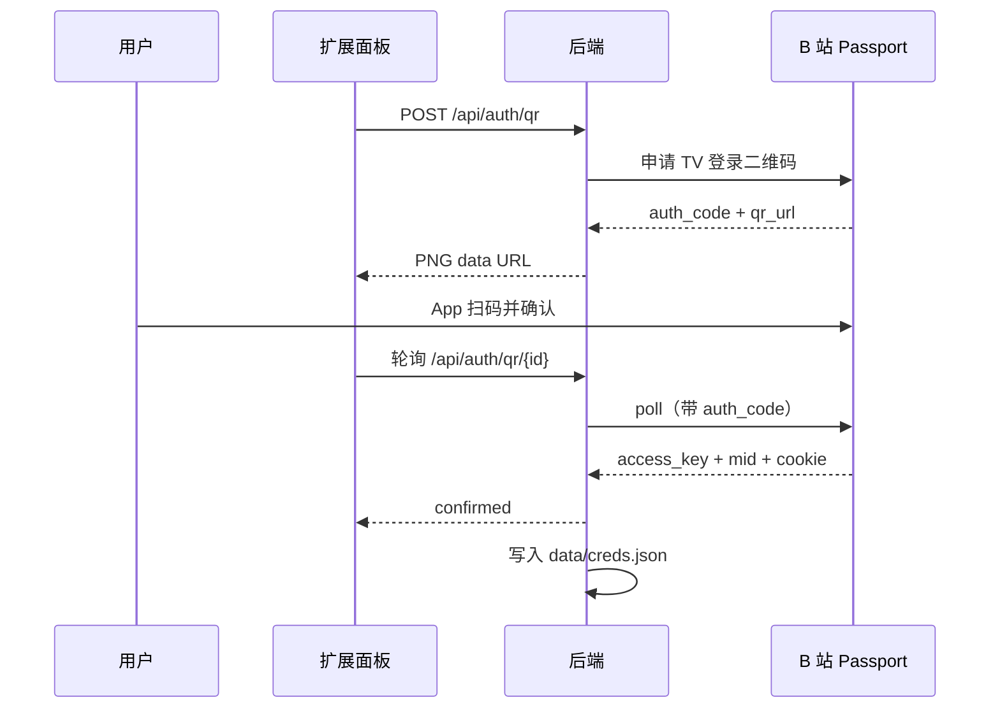
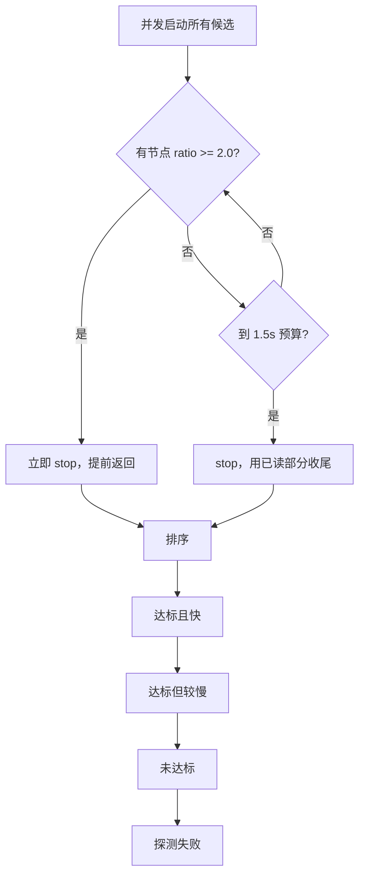
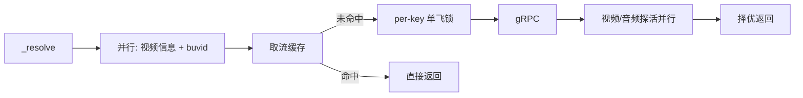
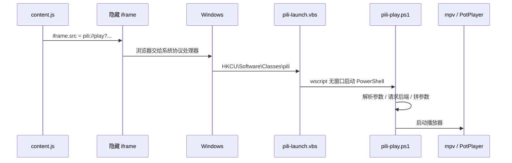

# Bili 4K 拉流 V3 原理

> [!abstract] 核心思路
> 浏览器拿不到 4K 直链，也不该持有 `access_key`；于是把「登录 + gRPC 取流 + 节点择优」放到自建后端，浏览器只负责选清晰度和拉起本机播放器。播放时让播放器直连 CDN，NAS 不转发视频数据。

配套操作步骤见 [[使用说明]]。

## 1. 总体架构



三个组件的职责边界：

| 组件   | 不做什么                 | 做什么                      |
| ---- | -------------------- | ------------------------ |
| 扩展   | 不直连 B 站、不保存密钥、不做 MSE | 选档位、请求后端、拉起协议、暂停网页视频     |
| 后端   | 不转发直连模式的视频流量         | 登录、gRPC 取流、节点择优、生成直链/MPD |
| 协议脚本 | 不解析视频、不下载分片          | 把 `pili://` 参数翻译成播放器命令行  |

## 2. 为什么必须有后端

### 2.1 CORS 与 CDN 预检

B 站 CDN 对浏览器 `OPTIONS` 预检返回 404，网页里直接 `fetch` 直链会失败；同时 gRPC 需要自定义 `authorization` 头，浏览器不允许网页随意设置。因此所有B站请求都在后端完成。

### 2.2 `access_key` 只留在服务端

TV 端扫码登录拿到的是 `access_key`，等价于账号凭证：

- 只写入 NAS 的 `data/creds.json`（权限 `0600`）；
- 接口只返回 `access_key_masked`（如 `abcd********wxyz`）；
- 扩展、日志、浏览器存储里都没有明文。

gRPC 调用时放在 metadata：

```
authorization: identify_v1 <access_key>
```

### 2.3 播放器才能吃下 4K

浏览器 MSE 方案要么经过后端中转、要么受跨域限制；实测 4K 实时码率约 13.7 Mbps，NAS 中转容易成为瓶颈。直连模式让 **播放器 → CDN**，后端只负责一次性给出地址。

## 3. 登录与取流

### 3.1 扫码登录



登录成功后，后续取流直接复用本地凭证，容器重建也不会掉登录。

### 3.2 gRPC 取流

调用：

```
bilibili.app.playerunite.v1.Player/PlayViewUnite
grpc.biliapi.net:443
```

请求里带设备元数据（buvid3、fawkes、device、locale、network 等），返回 `stream_list`（视频）和 `dash_audio`（音频）。每个流条目包含：

- `url` / `base_url` / `backup_url`；
- `qn`、`codecid`、`width`、`height`、`frame_rate`；
- `bandwidth`：该档位的声明码率，节点择优的基准；
- 试看信息：`trial_able`、`remaining_times`、`time_length`。

## 4. 画质与试看

### 4.1 档位不降级

用户要求「始终取最高可用画质」。实现上：

- 请求 `qn=120` 时，如果服务端下发了 120，就固定使用 120；
- 节点择优只在 **qn=120 的候选 URL 之间** 排序，不因为节点慢而改选 1080P；
- 只有「请求的档位根本不存在」时，才回退到服务端最高可用档，并通过 `notice` 说明。

因此 `direct.selection.quality_qn` 一定等于实际使用的 `selected.qn`，可以直接用它核对没有降档。

### 4.2 试看

未开通大会员时，4K 可能以试看形式下发（常见 300 秒、次数有限）。这是 B 站侧策略，后端只把 `trial` 原样返回并在 `notice` 提示。试看次数不会因为节点探测而额外消耗；取流结果本身有 300 秒缓存。

## 5. 三条播放路径

| 路径 | 接口 | 播放器 | 流量走向 | 适用 |
| --- | --- | --- | --- | --- |
| 直连模式 | `/api/play/direct` | mpv | 播放器 → CDN | 推荐，4K 首选 |
| MPD 直连 | `/api/play/mpd` | mpv / ffmpeg | 播放器 → CDN | 调试、外部播放器 |
| 代理模式 | `/api/play/potplayer.mpd` | PotPlayer | 播放器 → NAS → CDN | 兜底 |

### 5.1 直连模式与 EDL

mpv 支持用 EDL 把「视频流」和「音频流」拼成一个虚拟文件：

```
edl://!no_chapters;%<len>%<video_url>;!new_stream;!no_chapters;%<len>%<audio_url>
```

其中 `%N%` 的 `N` 是 URL 的 **UTF-8 字节长度**，不是字符数。后端在 `_edl()` 里计算并拼好，连同 mpv 参数一起返回：

```json
"mpv": {
  "args": [
    "--user-agent=bili-universal/8090300 ...",
    "--cache=yes",
    "--demuxer-max-bytes=512MiB",
    "--audio-file-auto=no",
    "edl://..."
  ]
}
```

关键点：

- **App 流不带 Referer**：`upos-sz-*` 对带 B 站 Referer 的请求判定为网页盗链，直接 403；带 `Lavf` 或浏览器 UA 也会 403。使用 App UA + 无 Referer 才稳定 200。
- `--audio-file-auto=no`：音频已经由 EDL 第二个流提供，禁止 mpv 再找外部音轨。
- `--cache=yes` 与较大的 `demuxer-max-bytes`：给 4K 留足缓冲。

启动协议里传的是 `pili://play?mode=mpv&api=<direct 接口>`，由 `pili-play.ps1` 自己请求后端并取 `mpv.args`，避免扩展与脚本两处逻辑漂移。

### 5.2 MPD 生成

后端用 Range 请求读取 m4s 前 128 KB，按 `ftyp/free/moov/sidx` 的 box 边界解析：

- 初始化段：`Initialization range="0-N"`；
- 索引段：`SegmentBase indexRange="..."`；
- 时长：从 `sidx` 的 timescale 与 segment 数计算。

生成的 `SegmentBase` 清单适合 mpv / ffmpeg，`BaseURL` 就是真正读到 `sidx` 的那个节点。

### 5.3 PotPlayer 代理

PotPlayer 对 `SegmentBase` 支持不好，会反复重拉清单。因此另生成 `SegmentTemplate` 分片清单：

- `BaseURL` 指向 `/api/play/seg/{token}/`；
- 分片由后端按 `sidx` 记录的字节范围回源转发；
- token 默认 2 小时有效，最多缓存 32 个会话。

这条路径的瓶颈是 NAS 带宽，只作兜底。

## 6. 节点择优算法

### 6.1 候选从哪来

`mpd.candidate_urls()` 按 PiliPlus `getCdnUrl` 的思路排列：

```
[upos 首选, 其他 upos, mcdn, 原始 base]
```

同一档位内保留 B 站给出的相对顺序，**只在这个列表内部做吞吐排序**。

### 6.2 怎么测

每个候选节点并发探测：

- 单节点 socket 超时 `0.75s`；
- 每次读 64 KB，单节点最多读 `2 MB`；
- 单类（视频或音频）总预算 `1.5s`；
- 实时记录「已读字节 / 起始时间」，预算到点时用部分结果参与比较。

计算：

```
bps   = bytes * 8 / elapsed
ratio = bps / bandwidth
```

`bandwidth` 来自 gRPC 下发的该档位码率。这样比较的是「相对该档位够不够快」，而不是绝对速度：4K 的 13.7 Mbps 和 1080P 的 3 Mbps 不能用同一把尺子。

### 6.3 怎么排序



排序规则：

1. `meets_threshold`（`ratio >= 1.5`）的节点在前，按 `ratio` 降序；
2. 未达标但可读的节点其次，按 `ratio` 降序；
3. 完全失败的节点最后；
4. 同分保留原候选顺序。

**低于门槛的节点不会排第一**，除非所有节点都不达标。达到 `2.0×` 时提前结束，避免等最慢节点。

### 6.4 全部不达标怎么办

不失败：

- 仍返回相对最快的可播放地址；
- `selection.*.degraded = true`；
- `notice` 写明「没有节点达到 1.5 倍码率门槛，已选择相对最快的 X」；
- 只有「该档位完全没有候选地址 / 没有下发流」时才返回 409。

### 6.5 测量缓存

测量值按「节点 + 路径」缓存（去掉 query）：

| 情况    | TTL  | 原因              |
| ----- | ---- | --------------- |
| 达标节点  | 60 秒 | 避免每次播放都重新完整探测   |
| 未达标节点 | 15 秒 | 不把「刚才很慢的节点」长期固化 |

缓存里只存 `bps/bytes/ms/ok`，`ratio` 在每次请求时按当前档位 `bandwidth` 现算，避免跨档位污染。

### 6.6 结果可见

`direct.probe[]` 每条包含：

| 字段 | 含义 |
| --- | --- |
| `host` | 节点域名 |
| `bytes` / `ms` / `bps` / `speed_mbps` | 实际读了多少、耗时、比特率 |
| `ratio` | 相对该档位码率的倍数 |
| `meets_threshold` | 是否达到 1.5 倍 |
| `cached` | 是否命中测量缓存 |
| `budget_hit` | 是否因预算到点而使用部分结果 |
| `error` | 失败原因（HTTP 状态码等） |

`direct.selection` 额外给出最终选中的 host、`quality_qn` 和 `degraded`，用于事后判断。

## 7. 并行与缓存

### 7.1 原先的串行点

| 串行点 | 影响 |
| --- | --- |
| 视频探活 → 音频探活 | 两组各等最慢节点，耗时相加 |
| 视频信息 → gRPC | 冷启动多等一次 HTTP |
| `resolve` 与 `direct` 并发 | 同一 key 可能重复 gRPC |
| 每次 gRPC 重新取 buvid | 多一次 HTTP |
| 每次播放完整探测 | 固定等待 1.5 秒级 |

### 7.2 现在的做法



- **视频/音频探活并行**：总等待约 1.5 秒，而不是两组相加；
- **取流单飞**：按 `aid:cid:qn:sha1(access_key)[:12]` 加锁，等锁期间二次查缓存；
- **buvid 缓存 1 小时**，gRPC 失败时刷新并重试一次；
- **视频信息缓存 2 分钟**；
- **取流结果缓存 300 秒**，减少试看次数消耗；
- 冷启动 `resolve` 仍以 gRPC 为主，因为必须先用 `cid` 才能取流，这部分无法再提前。

## 8. `pili://` 协议链



为什么这样设计：

- **隐藏 iframe**：网页无法直接启动本机程序，只能交给协议处理器；iframe 5 秒后移除，避免残留。
- **VBS 中转**：直接调 `powershell.exe` 会闪黑窗，`wscript` + VBS 可以隐藏窗口。
- **注册表只写 HKCU**：不需要管理员权限，不弹 UAC。
- **启动锁**：两个 `pili://` 同时到达时只拉起一个播放器，避免连点开两个窗口。
- **标题透传**：扩展把视频标题编码进 `pili://`，脚本追加 `--force-media-title=`，mpv 窗口与 OSC 顶部显示视频名。

`pili://check` 是不启动播放器的自检入口。

## 9. 拉起前暂停网页视频

扩展在 `launchProtocol()` 之前调用 `pausePageVideos()`：

1. 收集 `document.querySelectorAll("video")`；
2. 递归 `bwp-video` 等自定义元素的 `shadowRoot`（B 站自定义控件可能把 `<video>` 包在 shadow DOM 里）；
3. 递归同源 `iframe.contentDocument`（跨域忽略）；
4. 用 `Set` 去重；
5. 只对 `!video.paused` 的调用 `pause()`，返回 `{total, paused}`。

只暂停、不关闭，也不接管 B 站控件；用户回到网页点播放即可继续。直连与 PotPlayer 两条路径都会执行，状态提示追加「已暂停页面视频 N 个」。

## 10. 关键参数

| 参数 | 值 | 说明 |
| --- | --- | --- |
| 探测预算 | 1.5 s | 单类（视频/音频） |
| 单节点超时 | 0.75 s | socket 操作 |
| 单节点上限 | 2 MB | 够算稳定速率 |
| 分块大小 | 64 KB | 便于预算中断 |
| 达标门槛 | 1.5× | 相对该档位码率 |
| 提前返回 | 2.0× | 有节点达标即收敛 |
| 探活缓存 | 60 / 15 s | 达标 / 未达标 |
| 取流缓存 | 300 s | `PlayCache` |
| 视频信息 | 120 s | `TTLCache` |
| buvid | 3600 s | 失败可失效重取 |
| mpv 缓冲 | 512 MiB | `demuxer-max-bytes` |
| 代理 token | 2 h | 最多 32 个会话 |

## 11. 设计取舍与限制

> [!warning] 已知限制
> - 直连模式依赖 mpv；PotPlayer 不能同时接收独立视频/音频地址。
> - 冷启动 `resolve` 仍要等一次 gRPC，耗时受网络影响。
> - 试看时长与次数由 B 站控制，后端无法绕过。
> - 代理模式受 NAS 上行带宽限制，4K 通常跑不满。
> - mpv 命令行有 Windows 长度上限；EDL 过长时会退化为 `--audio-file`，再超则建议代理模式。

刻意不做的事：

- 不自动降档、不自动切档；
- 不在浏览器里做 MSE；
- 不把 `access_key` 下发给前端；
- 不为了「看起来更快」而永久缓存节点测量值。

## 12. 在 Obsidian 里使用这两篇笔记

- 两篇笔记放在同一目录，`[[使用说明]]` / `[[原理]]` 可直接双向跳转；
- 代码块使用语言标记，Obsidian 会高亮；
- `mermaid` 代码块由 Obsidian 原生渲染，无需插件；
- callout 语法 `> [!info]`、`> [!warning]` 可直接折叠/着色；
- frontmatter 里的 `tags` 可用于标签面板筛选（如 `#bilibili`、`#架构`）；
- 如需把本页导出给他人，用「导出为 PDF」即可保留图表。
